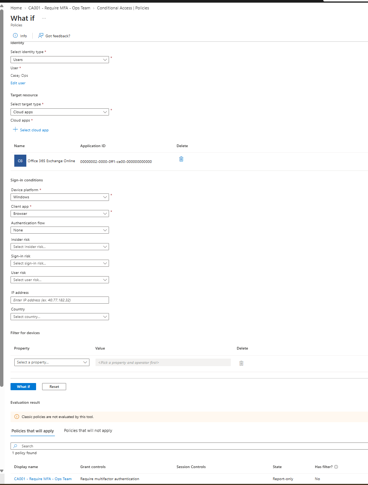
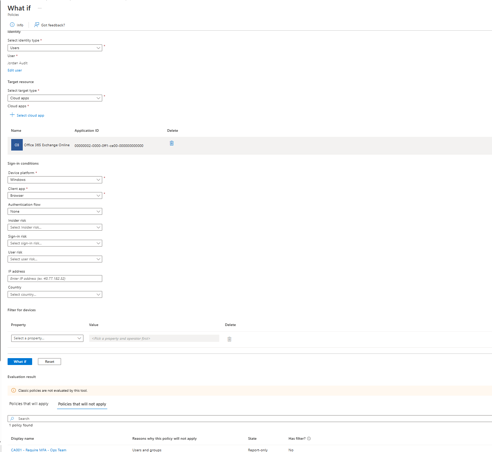
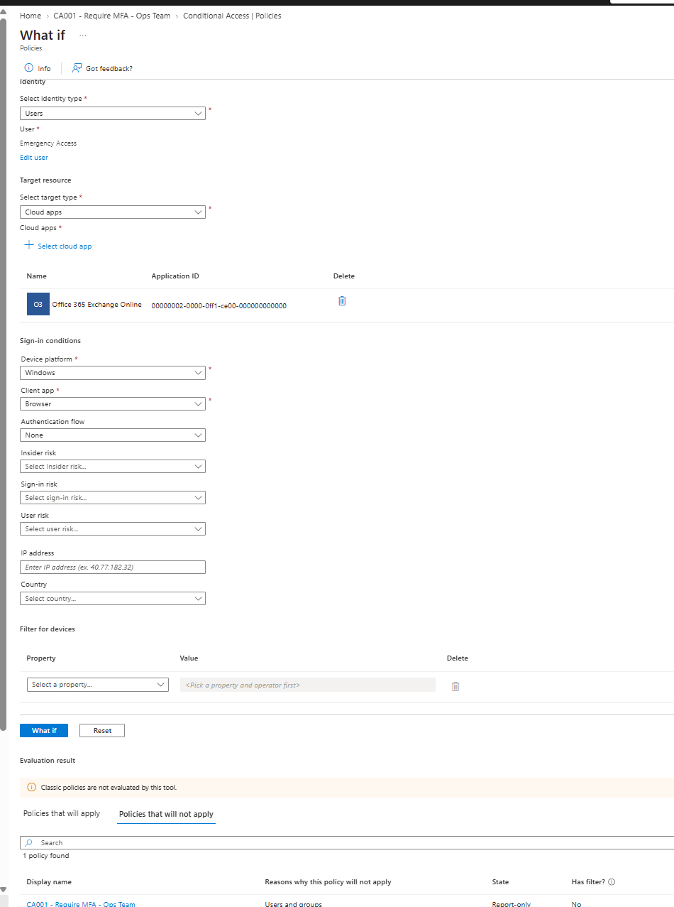
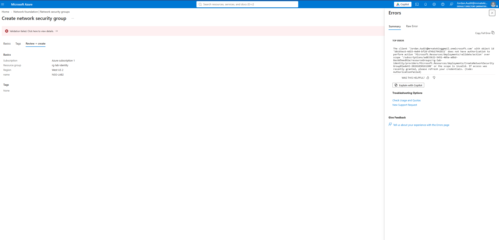
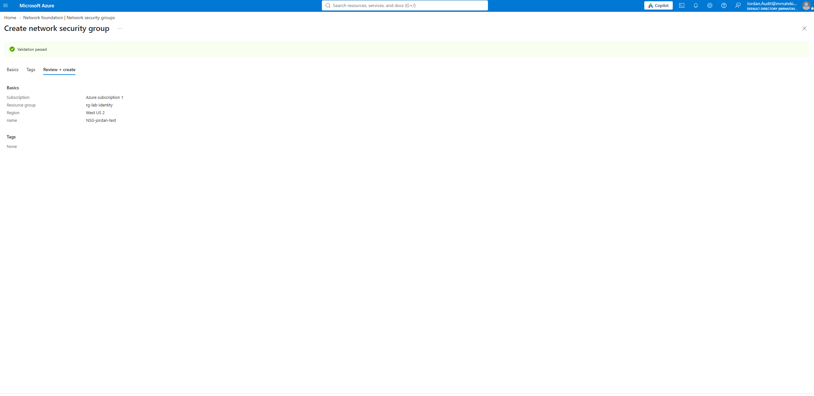

# Azure Identity Lab 2: Conditional Access MFA + Privileged Identity Management (PIM)

Building on [Lab 1 (group-based RBAC)](../), this lab adds two Microsoft Entra ID P2 security controls to the same tenant:

1. **Conditional Access**: require MFA for the Ops team only, with an emergency-access account excluded.
2. **Privileged Identity Management (PIM)**: remove standing write access. The Auditor must *activate* Contributor just-in-time, with a justification and a time limit.

## Environment

| Item | Value |
|---|---|
| License | Microsoft Entra ID P2 (30-day trial) |
| Resource group | `rg-lab-identity` |
| Ops group | `GRP-Ops-Contributors` (Alex, Sam, Casey): Contributor on the RG |
| Audit group | `GRP-Auditors-Readers` (Jordan): Reader on the RG |
| Emergency access | `breakglass1`: cloud-only Global Administrator, excluded from Conditional Access |
| Billing/admin account | `labadmin`: Global Administrator (Entra) with **PIM-eligible** User Access Administrator (Azure) |

---

## Part 1: Conditional Access (MFA for the Ops team)

### Policy: `CA001 - Require MFA - Ops Team`

| Setting | Value |
|---|---|
| Users: include | `GRP-Ops-Contributors` |
| Users: exclude | `breakglass1` |
| Target resources | All resources |
| Grant | Require multifactor authentication |
| State | Report-only first, validated before enforcement |

**Why these choices**
- **Security Defaults → Conditional Access.** Security Defaults is all-or-nothing. Conditional Access lets me target specific groups, apps, and conditions. Security Defaults had to be disabled first.
- **Break-glass exclusion.** If a policy is misconfigured, an excluded emergency account is the way back in. Microsoft recommends two or more; this lab uses one.
- **Scoped to one group first.** Targeting a small group (instead of All users) limits the blast radius while testing.
- **Report-only first.** I evaluated the policy's impact before enforcing it.

### Validation with the What If tool

The same policy produced three different results for three users. Each result has an explanation.

| User | Expected | Result |
|---|---|---|
| Alex (Ops) | Policy applies → MFA required | ✅ Applies |
| Jordan (Auditor) | Not in target group | ✅ Does not apply |
| breakglass1 | Explicitly excluded | ✅ Does not apply |





---

## Part 2: Privileged Identity Management (just-in-time access)

### Scenario
Jordan is an Auditor with permanent **Reader** access. Occasionally he needs to make a change. Instead of giving him permanent Contributor, he's **eligible** for Contributor on `rg-lab-identity` and must activate it when needed.

### Configuration
- PIM → Azure resources → `rg-lab-identity` → Assignments
- Role: **Contributor** · Member: **Jordan Audit** · Type: **Eligible**

### Test results

| Step | Result |
|---|---|
| Jordan creates an NSG **before** activation | ❌ Authorization denied |
| Jordan activates Contributor in PIM (with justification) | ✅ Activated, time-limited |
| Jordan signs out/in, then creates the NSG | ✅ Succeeds |




### Bonus: PIM for my own admin account
`labadmin` is a Global Administrator, but that's an **Entra** role. It had no **Azure** permissions on the subscription. Instead of giving it permanent access, I made it **eligible** for **User Access Administrator** with a **condition**: it can assign any role *except* privileged ones (Owner, User Access Administrator, RBAC Administrator). It has to activate that role, with a reason, before managing role assignments.

---

## Problems I hit and how I fixed them

**1. Couldn't start the Entra ID P2 trial.**
The **Try / Buy** button was disabled because license management has moved to the Microsoft 365 admin center. The trial signup also tried to create a *new tenant* because my Azure account is a personal Gmail-based Microsoft account. **Fix:** I created a cloud-only `labadmin@<tenant>.onmicrosoft.com` Global Admin and started the trial from that account so it attached to the existing tenant.

**2. License assignment failed: "invalid usage location."**
Licenses can't be assigned until a user has a **Usage location** set. **Fix:** I set the location to United States for each user. It can also be done in bulk through Microsoft Graph:
```bash
az rest --method patch \
  --url "https://graph.microsoft.com/v1.0/users/<upn>" \
  --body '{"usageLocation":"US"}'
```

**3. Global Admin couldn't see the subscription in PIM.**
Global Administrator (Entra role) does **not** grant Azure resource access. PIM for Azure resources requires Owner or User Access Administrator on the subscription. **Fix:** PIM-eligible User Access Administrator for `labadmin` (see Bonus above).

**4. New permissions didn't show up right away.**
After activating a PIM role, the portal didn't reflect it until I **signed out and back in**. This happened for both `labadmin` and Jordan.

---

## Key takeaways

- **Entra roles ≠ Azure RBAC roles.** Directory admin and resource admin are separate permission systems.
- **Standing access vs. just-in-time access.** PIM removes always-on privilege. Access is requested, justified, time-boxed, and audited.
- **Test before you enforce.** Report-only mode and the What If tool let you check a Conditional Access policy without locking anyone out.
- **Always have a way back in.** Emergency-access accounts are excluded from Conditional Access by design.

## Tools
Microsoft Entra admin center · Microsoft 365 admin center · Azure portal · Azure CLI / Microsoft Graph

## References
- [Require MFA for all users with Conditional Access](https://learn.microsoft.com/entra/identity/conditional-access/policy-all-users-mfa-strength)
- [Troubleshoot Conditional Access with the What If tool](https://learn.microsoft.com/entra/identity/conditional-access/troubleshoot-conditional-access-what-if)
- [Manage emergency access accounts](https://learn.microsoft.com/entra/identity/role-based-access-control/security-emergency-access)
- [Assign Azure resource roles in PIM](https://learn.microsoft.com/entra/id-governance/privileged-identity-management/pim-resource-roles-assign-roles)
- [Assign licenses: usage location requirement](https://learn.microsoft.com/entra/identity/users/licensing-admin-center)
