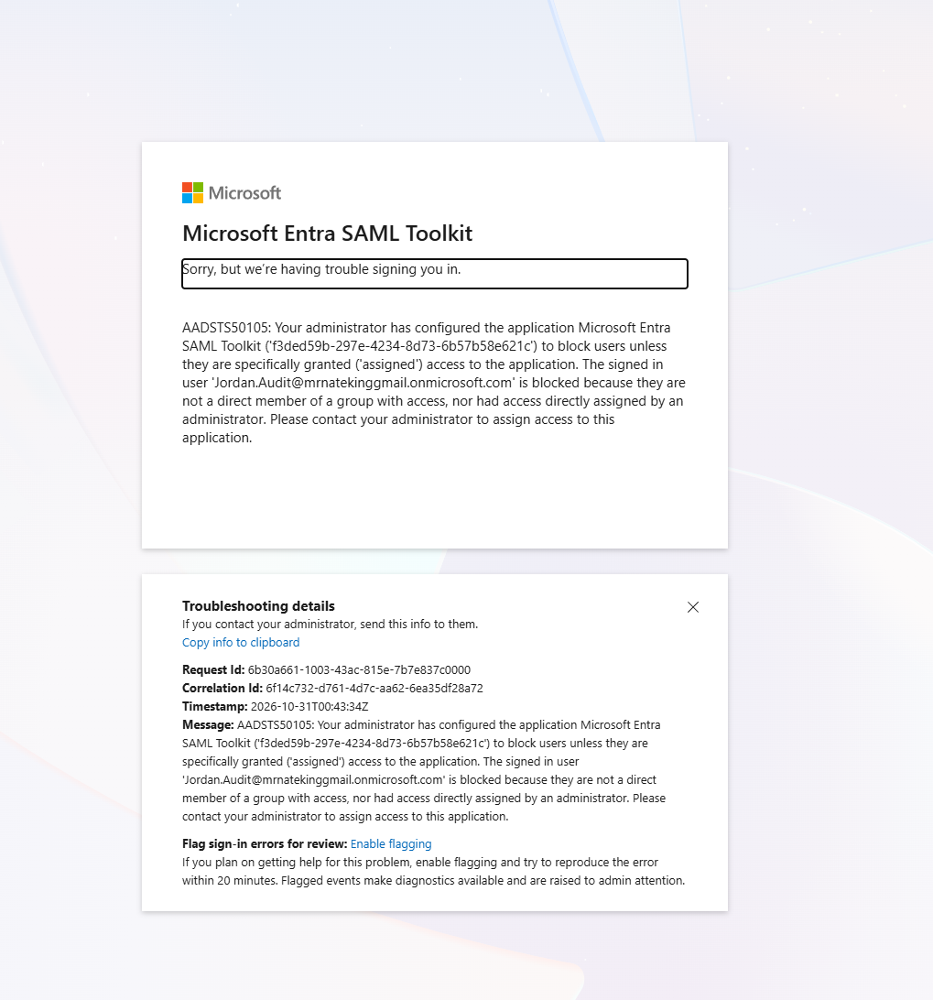

# Azure Identity Lab 3: SAML Single Sign-On with an Enterprise App

Building on [Lab 1 (group-based RBAC)](../) and [Lab 2 (Conditional Access + PIM)](../Project2/), this lab connects an application to Microsoft Entra ID with **SAML single sign-on (SSO)**. Only the Ops team can use the app, and the Conditional Access MFA policy from Lab 2 protects it automatically.

## Why SSO matters

- **One identity:** users sign in with their Entra account; there's no separate app password to manage.
- **Central control:** disabling a user in Entra cuts off every connected app at once (clean offboarding).
- **Consistent security:** Conditional Access policies (like MFA) apply to the app with no extra work.

## What I built

| Component | Value |
|---|---|
| Enterprise app | Microsoft Entra SAML Toolkit (Microsoft's test app from the Entra gallery) |
| SSO method | SAML 2.0, service-provider (SP) initiated |
| Assignment required | **Yes**, only assigned users/groups can sign in |
| Assigned to | `GRP-Ops-Contributors` (group-based assignment, requires Entra ID P1/P2) |
| Not assigned | Jordan (Auditor), used to prove the restriction works |
| Conditional Access | `CA001 - Require MFA - Ops Team` (from Lab 2) targets **All resources**, so it covers this app |

### How the SAML trust is set up

| Setting | Purpose |
|---|---|
| **Identifier (Entity ID)** | Who the app is. Entra puts this in the token's *Audience* |
| **Reply URL (ACS)** | Where Entra posts the signed SAML response |
| **Sign-on URL** | The app's login link that starts SP-initiated SSO |
| **Login URL / Entra Identifier** (given to the app) | Where the app sends users to sign in, and which issuer it should trust |
| **Signing certificate** | The app uses it to verify the response really came from my tenant |

---

## Test 1: Assigned user (Alex) gets a valid SAML assertion

I captured the SAML response Entra sent to the app and decoded it (base64 → XML) to verify each field:

| Field in the SAML response | Value | Verified |
|---|---|---|
| Status | `Success` | ✅ Entra approved the sign-in |
| Issuer | `https://sts.windows.net/<tenant-id>/` | ✅ My tenant |
| Destination / Recipient | `…/SAML/Consume/<config-id>` | ✅ Matches the Reply URL |
| Audience | `https://samltoolkit.azurewebsites.net` | ✅ Matches the Identifier |
| NameID (emailAddress format) | `alex.ops@<tenant>.onmicrosoft.com` | ✅ Correct user |
| Signature | RSA-SHA256 + X.509 certificate | ✅ Signed by Entra |
| Validity window | About 1 hour | ✅ Short-lived by design |

> Raw tokens are intentionally not included in this repo. They're signed login credentials.

### Before and after: proving Conditional Access in the token

I compared two SAML responses for the same user and app. The only change between them was switching `CA001` from **Report-only** to **On**:

| | CA001 = Report-only | CA001 = On |
|---|---|---|
| `authnmethodsreferences` claim | `password` | `password` + **`multipleauthn`** |
| Meaning | Password only | **MFA completed** |

This shows the MFA policy being enforced in the token itself, not just in the portal.

---

## Test 2: Unassigned user (Jordan) is blocked

Jordan isn't in `GRP-Ops-Contributors`, so Entra blocked him at the Microsoft sign-in page. No SAML response was ever sent to the app.

**AADSTS50105:** the app requires assignment, and the user isn't a direct member of an assigned group or directly assigned. The error page includes a **Request ID** and **Correlation ID**. These can be matched to the Entra sign-in logs, or sent to Microsoft support.

| User | Assigned? | Result |
|---|---|---|
| Alex (Ops) | ✅ via group | Signed SAML assertion issued, with MFA |
| Jordan (Auditor) | ❌ | Blocked: AADSTS50105 |

---

## Problems I hit and how I worked through them

**1. App tile didn't appear in My Apps.**
The assignment and "Visible to users" were configured correctly, but the tile didn't show up right away. My Apps is only a launcher, so I tested SSO directly with the app's SP-initiated login URL.

**2. Reply URL / Sign-on URL mismatch.**
The test app generates its own per-configuration URLs (`/SAML/Login/<id>` and `/SAML/Consume/<id>`). These had to be copied back into Entra's Basic SAML Configuration, replacing the generic defaults.

**3. The test app's receiving page returned a generic error.**
After Entra sent a successful response, the SAML Toolkit's ACS page showed "An error occurred while processing your request." I:
- **Isolated the problem** by decoding the SAML response. Status, audience, recipient, NameID, and signature were all correct, so the Entra (identity provider) side was verified.
- **Rebuilt the app-side config** with the exact Login URL, Issuer (including trailing `/`), Logout URL, and **Certificate (Raw)**.
- **Found it's a known, long-standing issue** with this demo app (reported on Microsoft Q&A and GitHub, where a Microsoft moderator recommended using a different test app).

**Conclusion:** the identity provider configuration is verified. The remaining failure is in the third-party test app. In production, I'd open a ticket with the app vendor and attach the decoded SAML response as evidence.

---

## Key takeaways

- **SAML is a trust relationship.** Identifier, Reply URL, issuer, and signing certificate must match on both sides.
- **"Assignment required" + group assignment** = least privilege at the application level.
- **Conditional Access scoped to All resources** protects new apps automatically.
- **Decode the token when troubleshooting.** It shows exactly what the identity provider sent, so you can tell an IdP problem from an app problem.

## Tools
Microsoft Entra admin center · Microsoft Entra SAML Toolkit · Browser dev tools / base64 decoding

## References
- [Enable single sign-on for an enterprise application](https://learn.microsoft.com/entra/identity/enterprise-apps/add-application-portal-setup-sso)
- [Tutorial: Microsoft Entra SSO integration with Microsoft Entra SAML Toolkit](https://learn.microsoft.com/entra/identity/saas-apps/saml-toolkit-tutorial)
- [Manage users and groups assignment to an application](https://learn.microsoft.com/entra/identity/enterprise-apps/assign-user-or-group-access-portal)
- [Manage access to an application](https://learn.microsoft.com/entra/identity/enterprise-apps/what-is-access-management)
