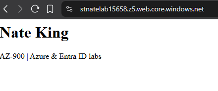
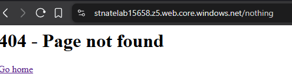

# Azure Lab 4: Static Website Hosting on Azure Blob Storage

Part of my Azure lab series: [Lab 1: RBAC](../) · [Lab 2: Conditional Access + PIM](../Project2/) · [Lab 3: SAML SSO](../Project3/)

**Live site:** (https://stnatelab15658.z5.web.core.windows.net/)

A public website hosted directly from Azure Storage. There's no VM or web server to manage, and it costs pennies a month. Everything was built with the **Azure CLI** in Cloud Shell, plus the portal for one setting.

## What I built

| Component | Value | Why |
|---|---|---|
| Resource group | `rg-lab-web` | Keeps the website resources separate from the identity labs. Easy to delete in one step. |
| Storage account | `stnatelab<random>` (StorageV2) | Storage account names must be globally unique, lowercase, 3–24 characters. |
| Redundancy | **Standard_LRS** | Cheapest option (3 copies in one datacenter). Fine for a non-critical site. |
| Region | West US 2 | |
| Static website | Enabled | Azure automatically creates a special **`$web`** container that serves files as a website |
| Index document | `index.html` | Served at the site root |
| Error document | `404.html` | Served for any page that doesn't exist |

## How I built it (Azure CLI)

```bash
RG="rg-lab-web"; SA="stnatelab$RANDOM"; LOC="westus2"

# Resource group + storage account
az group create --name $RG --location $LOC
az storage account create --name $SA --resource-group $RG --location $LOC \
  --sku Standard_LRS --kind StorageV2

# Static website was enabled in the portal:
#   Storage account → Data management → Static website → Enabled
#   Index: index.html · Error: 404.html

# Create the site files
mkdir -p site
echo '<h1>Nate King</h1><p>AZ-900 | Azure & Entra ID labs</p>' > site/index.html
echo '<h1>404 - Page not found</h1><a href="/">Go home</a>' > site/404.html

# Upload to the special $web container
az storage blob upload-batch --account-name $SA --source site \
  --destination '$web' --auth-mode key --overwrite

# Get the public URL
az storage account show -n $SA -g $RG --query "primaryEndpoints.web" -o tsv
```

## Testing

| Test | Expected | Result |
|---|---|---|
| Open the site URL | Homepage loads | ✅ |
| Open a page that doesn't exist | Custom 404 page | ✅ |




## Problems I hit and how I fixed them

**1. `$web` in Bash.**
The container name must be in single quotes (`'$web'`). Otherwise Bash treats `$web` as an empty variable.

## Key concepts

- **Static website hosting:** Azure Storage can serve HTML/CSS/JS directly. It suits portfolios, docs, and front-end apps that don't need server-side code. (For custom headers, built-in auth, or CI/CD from GitHub, Azure Static Web Apps is the alternative.)
- **Redundancy options:** LRS (one datacenter) → ZRS (zones) → GRS/GZRS (paired region). Pick based on how critical the data is versus the cost.
- **Access keys vs. Entra ID auth:** I uploaded using the storage account **key** (`--auth-mode key`). Using `--auth-mode login` instead requires a **data-plane role** like *Storage Blob Data Contributor*. Being an Owner (a management-plane role) isn't enough on its own. This is the same management-vs-data split as Entra roles vs Azure roles from Lab 1.
- **Cost control:** everything lives in one resource group, so `az group delete -n rg-lab-web` removes it all.

## Tools
Azure Cloud Shell (Bash) · Azure CLI · Azure portal

## References
- [Tutorial: Host a static website on Blob Storage](https://learn.microsoft.com/azure/storage/blobs/storage-blob-static-website-host)
- [az storage blob service-properties (CLI reference)](https://learn.microsoft.com/cli/azure/storage/blob/service-properties)
